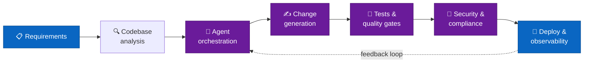

# Emre Toprak

 

<h3>Head of AI Engineering · AI Product Engineer · Fintech Architect</h3>

<em>Generative AI · Agentic Systems · RAG · MCP</em>

Istanbul, Türkiye · [**emretoprak.com**](https://emretoprak.com)

 

[About](#-about) · [Focus](#-areas-of-focus) · [Experience](#-experience) · [Work](#-selected-work) · [Talks](#-talks--events) · [Stack](#-tech-stack) · [Education](#-education) · [Links](#-links)

---

---

## 👋 About

With **20+ years in software engineering**, architecture and technical leadership, I build scalable systems at the intersection of **enterprise software, fintech and AI**.

Today, as **Head of AI Engineering at [ForInvest](https://www.forinvest.com)**, I focus on turning Generative AI from experimentation into **reliable, production-grade engineering capabilities**.

My background spans high-performance financial systems, distributed architectures, and backend, desktop, mobile and web engineering. That breadth lets me approach AI not as an application layer bolted on top, but as part of the **entire software engineering lifecycle** — architecture, development, testing, security, deployment and operations.

I am especially interested in building **AI agents that become reliable participants in the SDLC**: understanding requirements, analyzing codebases, generating and validating changes, improving test coverage, and supporting engineering teams.

Operating with an **AI Product Engineer** mindset, I bridge product discovery, business analysis, UX/system design, implementation and QA — wearing multiple hats to take AI initiatives from concept to production.

As a technical leader, I simplify complex engineering environments, connect multidisciplinary teams, and set pragmatic standards that let teams move faster without compromising reliability, security or scalability.

> [!NOTE]
> Current role, talks and the full bilingual profile are maintained at **[emretoprak.com](https://emretoprak.com)** · [Türkçe](https://emretoprak.com/tr/)

---

## 🎯 Areas of Focus

| | Focus | What it means in practice |
| :---: | :--- | :--- |
| ⌁ | **AI Engineering & Agentic AI** | Agentic systems, autonomous agents, conversational graphs and AI-powered developer tools |
| ◉ | **AI Product Engineering** | End-to-end delivery — discovery, business analysis, UX/UI prototyping, full-stack build and QA, concept to production |
| ◈ | **Domain-Specific LLMs & Financial AI** | Financial terminology, workflows and domain knowledge; fine-tuning, model evaluation, production readiness |
| ◌ | **Generative AI, RAG & MCP** | RAG architectures, Model Context Protocol integrations, semantic graphs, production-grade GenAI |
| ⌬ | **AI-Native Software Engineering** | AI across architecture, dev, testing, security and ops to lift engineering productivity and R&D efficiency |

### How I think about AI-native engineering

<em>Humans own intent and outcomes; agents handle analysis, generation and verification inside guardrails.</em>

---

## 💼 Experience

| Role | Company | Period |
| :--- | :--- | :--- |
| **Head of AI Engineering** | ForInvest | Aug 2025 — Present |
| **Senior Software Developer Team Lead** | ForInvest | Dec 2022 — Aug 2025 |
| **Software Team Lead** | Foreks | Oct 2014 — Dec 2022 |
| **Senior Software Developer** | Innova | Jul 2012 — Feb 2014 |
| **Software Developer** | IBS Software | Aug 2009 — Jul 2012 |
| **Web Developer** | avkom | Aug 2006 — Jul 2009 |

 

### 🟣 ForInvest — Head of AI Engineering

> Building financial AI ecosystems on Model Context Protocol.

| Area | What I shipped |
| :--- | :--- |
| **Platforms** | [**ForMind**](https://formind.forinvest.com) + [**ForInvest MCP**](https://mcp.forinvest.com) — financial AI and MCP ecosystems |
| **Product Engineering** | **End-to-end AI delivery** — product discovery, business analysis, UX/UI prototyping, full-stack implementation and QA, concept to production |
| **Orchestration** | **AgentCore** — multi-LLM workflows across Claude, OpenAI and Google models |
| **Dev Tooling** | **AI Developer agent** — GitLab-integrated; reads codebases, resolves issues, opens MRs |
| **Retrieval** | Advanced **RAG** — financial document indexing, hybrid retrieval and semantic graphs |
| **Models** | **LLM fine-tuning** pipelines adapted to financial terminology and workflows |
| **Quality** | AI-driven **CI/CD gates** — code analysis, vulnerability scanning, compliance, synthetic tests |
| **Frameworks** | **LangChain**, **LangGraph** and **Langflow** for agents and conversational graphs |

<b>Earlier roles — highlights</b>

 

**Senior Software Developer Team Lead · ForInvest (2022 – 2025)**
- Led cross-functional teams delivering highly available, mission-critical fintech systems with Node.js, Java and modern frontend frameworks
- Owned enterprise system design and architectural decisions for resilience, fault tolerance and loose coupling
- Handled billions of monthly requests via a widget-serving asset infrastructure backed by Cloudflare caching and edge computing
- Built PCI-compliant global payment gateway integrations and high-throughput transaction processing
- Delivered financial dashboards and live tracking clients with React, React Native and Vue
- Directed deep-learning and big-data initiatives turning unstructured market data into analytical assets

**Software Team Lead · Foreks (2014 – 2022)**
- Engineered an end-to-end Financial Data Terminal: live streaming market data, real-time technical analysis and advanced financial metrics
- Spearheaded a cloud-native migration from monolithic legacy apps to a Java/Node.js microservices architecture
- Cut infrastructure costs by consolidating complex multi-server topologies into efficient single-server setups
- Orchestrated the UI/UX rewrite of core data products with React and Vue
- Built algorithmic trading systems with TensorFlow for market prediction and strategy backtesting

**Senior Software Developer · Innova (2012 – 2014)**
- Developed enterprise banking and corporate payment systems: automated collection, reconciliation and settlement engines
- Scaled critical financial integrations including E-Invoice (E-Fatura) compliance and cross-platform ERP sync layers
- Implemented backend business logic with .NET, MVC patterns and NHibernate ORM

**Software Developer · IBS Software (2009 – 2012)**
- Built real-time web-based financial streaming apps with live market tickers and interactive widgets embedded in third-party portals
- Developed multi-threaded market data processing tools and desktop/web trading interfaces on .NET

**Web Developer · avkom (2006 – 2009)**
- Engineered custom web applications, dynamic CMS platforms and commercial portals with PHP
- Designed and integrated business workflows on .NET CRM platforms
- Crafted tailored UI/UX through custom frontend styling and layouts

---

## 🚀 Selected Work

<table>
<tr>
<td width="50%" valign="top">

**🧠 ForMind**
Financial AI platform for research and investment workflows.
`GenAI` `MCP` `Financial AI`

**🤖 ForInvest MCP**
Model Context Protocol ecosystem exposing financial data to AI agents.
`MCP` `API design` `Agents`

**⚙️ AgentCore**
Multi-LLM orchestration infrastructure for enterprise agents.
`Orchestration` `Claude` `OpenAI` `Google`

**🛠️ AI Developer Agent**
GitLab-integrated autonomous agent: reads code, resolves issues, opens MRs.
`Agentic` `GitLab CI` `SDLC`

</td>
<td width="50%" valign="top">

**📚 Financial RAG & Fine-Tuning**
Document indexing, hybrid retrieval, semantic graphs and domain-adapted financial LLMs.
`RAG` `Fine-tuning` `Vector search`

**🔐 AI Quality Gates**
Automated code analysis, vulnerability scanning and synthetic test generation in CI/CD.
`Quality` `Security` `CI/CD`

**📈 Financial Data Terminal**
Real-time streaming charts, technical analysis modules and financial metrics.
`Streaming` `React` `Java`

**🌍 Widget Serving Infrastructure**
Billions of monthly requests served from the edge.
`Cloudflare` `Edge` `Scale`

</td>
</tr>
</table>

---

## 🎤 Talks & Events

<table>
<tr>
<td width="50%">

<b>AWS Cloud Day Istanbul</b> — Generative AI in financial services
</td>
<td width="50%">

<b>Agentic AI Türkiye</b> — Twin Strikers: AWS AI & Cloud
</td>
</tr>
<tr>
<td width="50%">

<b>AWS · AI Engineering</b> — How ForInvest Accelerates FinTech Innovation with Kiro
</td>
<td width="50%">

<b>AWS Cloud Day Türkiye</b> — Generative AI on financial investment decisions
</td>
</tr>
<tr>
<td colspan="2" align="center">

 
<b>ForInvest InvestTech Summit '25</b> — Yapay Zeka Merkezli Nasıl Olunur
</td>
</tr>
</table>

---

## 🧰 Tech Stack

<b>Full skills inventory</b>

 

**AI & Machine Learning**
AI Product Engineering · Human-in-the-loop Machine Learning · Agent orchestration · AI observability · LangChain · Large Language Models (LLM) · LangGraph · Langflow · RAG · MCP · Deep Learning · Machine Learning · Financial AI · TensorFlow · Algorithmic Trading

**Backend**
Java · Spring · Node.js · Python · .NET Framework · NHibernate · PHP

**Frontend & Mobile**
TypeScript · JavaScript · React · React Native · Vue · HTML

**Data & Protocols**
PostgreSQL · MSSQL · MongoDB · Redis · Vector search · REST · WebSocket

**Architecture & Platform**
Software Architecture · Distributed systems · Microservices · Kafka · Cloudflare · Docker · Kubernetes · CI/CD · Full-Stack Development

---

## 🎓 Education

<table>
<tr>
<td width="50%" valign="top">

**Sakarya University**
`MSc` Computer / Information Engineering

Deep learning frameworks for real-time virtual market data analysis and prediction, predictive systems for stock-market simulations, financial data processing and technical analysis research.

</td>
<td width="50%" valign="top">

**Istanbul University**
`Bachelor's` Management Information Systems

Database management systems, systems analysis & design, object-oriented programming and data structures, connected with business administration and project management.

</td>
</tr>
</table>

---

## 🌐 Languages

| Language | Level |
| :--- | :--- |
| 🇹🇷 **Turkish** | Native or bilingual proficiency |
| 🇬🇧 **English** | Professional working proficiency |

---

## 🔗 Links

 

[**Türkçe profil**](https://emretoprak.com/tr/) · [**llms.txt**](https://emretoprak.com/llms.txt) · [**Machine-readable profile**](https://emretoprak.com/llms.txt)

---

Building AI-native financial systems at <a href="https://www.forinvest.com">ForInvest</a> · © Emre Toprak

